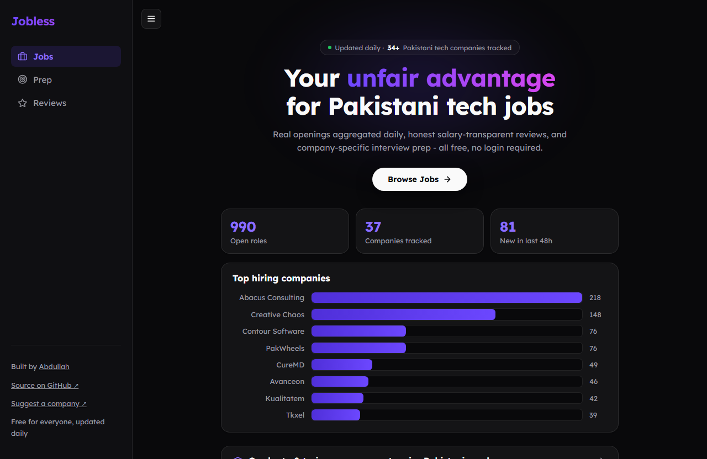
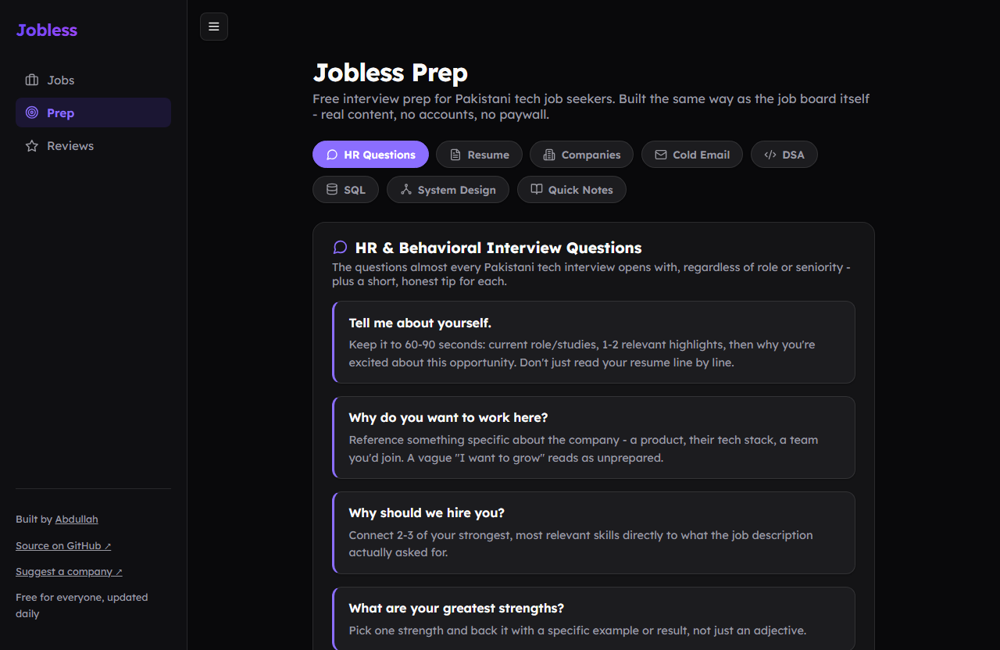

<div align="center">

# Jobless

**The go-to job board for the Pakistani software industry.**

Real openings aggregated daily from company career pages, honest company-specific interview prep, and (coming soon) salary-transparent reviews — all free, no login required.

[](https://github.com/AbdullahHAK/jobless/actions/workflows/ci.yml)
[](https://github.com/AbdullahHAK/jobless/actions/workflows/security-scan.yml)
[](https://github.com/AbdullahHAK/jobless/actions/workflows/daily-scrape.yml)
[](LICENSE)
[](pyproject.toml)

[**Live Site**](https://abdullahhak.github.io/jobless/) · [Suggest a Company](https://github.com/AbdullahHAK/jobless/issues/new?template=company-suggestion.yml) · [Report an Issue](https://github.com/AbdullahHAK/jobless/issues/new)



</div>

## Why Jobless

Finding a tech job in Pakistan today means checking dozens of individual company career pages, one by one, because no single aggregator reliably covers the local market. Jobless exists to be the one place that does — scraping every company's career page daily, normalizing the results into one searchable list, and shipping it as a free static site with no account wall between a candidate and an apply button.

The project is still growing toward its first-launch target of **100 companies tracked**; it's at 48 today.

## Table of Contents

- [Features](#features)
- [How It Works](#how-it-works)
- [Companies Tracked](#companies-tracked)
- [Tech Stack](#tech-stack)
- [Getting Started](#getting-started)
- [Deploying](#deploying)
- [API Reference](#api-reference)
- [Contributing](#contributing)
- [License](#license)

## Features

### 📋 Job Board
Every listing scraped straight from the source company's own career page — no third-party reposts, no expired links. Updated daily via a scheduled GitHub Actions run, with per-company failure isolation so one broken scraper never takes down the rest of the catalog.

### 🎯 Jobless Prep
A free interview-prep hub built with the same no-nonsense, no-signup philosophy as the job board itself: HR/behavioral questions, resume guidance, cold-email templates, a DSA/SQL/system-design primer, company-specific interview notes sourced from real candidate-reported experiences, and role-wise guides for Frontend, Backend, Fullstack, Mobile, DevOps, Data/AI-ML, and QA tracks.



### ⭐ Jobless Reviews *(backend not deployed yet)*
Salary-transparent, moderated company reviews — the API exists (`POST /reviews`, admin-gated moderation queue) but isn't deployed publicly yet, so the reviews page currently shows a "launching soon" state.

## How It Works

```
Company career page  →  Scraper plugin  →  PostgreSQL (upsert on apply_link)  →  Static JSON export  →  GitHub Pages
```

Each company is a self-contained scraper module implementing a common interface that returns a standard `Job` (title, company, location, apply_link, date_scraped). A registry auto-discovers every scraper dropped into `src/jobless/scrapers/` — no wiring required to add a new one. Each scraper picks whatever data source is actually cleanest for that company's site (a public JSON API discovered via network inspection, static HTML, or rarely a JS payload embedded in the page), documented in a comment at the top of its module.

Every scraper runs in isolation — one company's site changing or timing out is logged and skipped, not fatal to the run. Results are upserted into PostgreSQL keyed on `apply_link`, so re-scraping a still-open job updates it in place instead of duplicating it. A listing is only marked closed if the company's own scraper ran successfully and the listing was genuinely absent from the result — a transient failure never wipes out real data.

## Companies Tracked

<details>
<summary><strong>48 companies</strong> and counting — click to expand</summary>

<br>

10Pearls · 7Vals · Abacus Consulting · Arbisoft · ArhamSoft · Avanceon · Bazaar Technologies · Careem · Codup · Confiz · Contour Software · Convo · Creative Chaos · CureMD · DPL · Devsinc · Dubizzle · Educative · EurosHub · Folio3 · Genetech Solutions · i2c Inc · Inbox Business Technologies · InvoZone · JS Bank · Joblogic · KalSoft · Kualitatem · Mindstorm Studios · Motive · NayaPay · NetSol Technologies · Nextbridge · Ovex Technologies · PakWheels · Pakistan Single Window · Prime System Solutions · Remotebase · SadaPay · Safepay · Securiti (Veeam) · Smart Working Solutions · Strategic Systems International · Tkxel · Trango Tech · VentureDive · Zameen.com · Zones

</details>

Don't see a company you'd like tracked? [Suggest it →](https://github.com/AbdullahHAK/jobless/issues/new?template=company-suggestion.yml)

## Tech Stack


| Layer | Choice |
|---|---|
| Scraping | Python, `requests` + BeautifulSoup (Playwright kept on hand for one-off reconnaissance of JS-heavy sites, not needed at runtime by any current scraper) |
| Storage | PostgreSQL |
| Backend | FastAPI, rate-limited per client IP on write endpoints and `/jobs` |
| Email digests | Daily/weekly new-postings emails via Resend, driven by scheduled GitHub Actions workflows |
| Frontend | Plain HTML/CSS/JS — no framework, no build step |
| Containers | Docker, multi-stage builds for the API, scraper, and frontend |
| Orchestration | Kubernetes via a Helm chart (`charts/jobless/`) — scraper as a CronJob, API/frontend as Deployments |
| CI/CD | GitHub Actions (tests, Docker builds, security scanning on every push) + ArgoCD GitOps syncing the cluster to `main` |
| Monitoring | `/metrics` in Prometheus format, plus a `ServiceMonitor` for kube-prometheus-stack |

## Getting Started

```bash
uv sync                                    # install dependencies
docker compose up -d                       # start Postgres
uv run jobless                             # run every scraper once, store results
uv run uvicorn jobless.api:app --reload    # serve the API on :8000
```

Then open `frontend/index.html` (e.g. `python -m http.server` from `frontend/`) — it reads job listings straight from `frontend/data/jobs.json`, no API needed to browse.

```bash
uv run python -m pytest -v                 # run the test suite
```

## Deploying

```bash
docker build -t jobless-api -f Dockerfile .
docker build -t jobless-scraper -f Dockerfile.scraper .
docker build -t jobless-frontend -f Dockerfile.frontend .

helm install jobless charts/jobless --create-namespace --namespace jobless
```

`scripts/smoke-test.sh` runs the full build → KinD cluster → Helm install → trigger a scrape → verify the API sequence end to end. It's also wired up as a manually-triggered GitHub Actions workflow (`smoke-test.yml`) since it performs a real scrape of all tracked companies' live sites and shouldn't run automatically on every push.

## API Reference

| Method | Endpoint | Description |
|---|---|---|
| `GET` | `/health` | Liveness check |
| `GET` | `/companies` | List of all tracked companies |
| `GET` | `/jobs` | All current job listings |
| `POST` | `/subscribe` | Subscribe to a daily or weekly new-postings email digest |
| `GET` | `/unsubscribe` | Unsubscribe link target (emailed to subscribers) |
| `POST` | `/reviews` | Submit a company review (stored unapproved, pending moderation) |
| `GET` | `/reviews` | Approved reviews only |
| `POST` | `/reviews/{id}/approve` `/reject` | Moderation actions — requires `ADMIN_TOKEN` as the `X-Admin-Token` header |
| `GET` | `/metrics` | Prometheus-format metrics |

## Contributing

Issues and PRs are welcome — whether that's a bug report, a company suggestion, or a new scraper. If you're adding a scraper, drop a new module into `src/jobless/scrapers/`; the registry picks it up automatically, no other wiring needed.

## License

[MIT](LICENSE) © Abdullah
